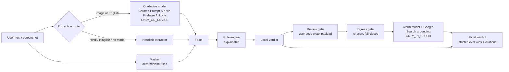

# Sajag — architecture

## Overview

## Hybrid routing table

| Task | Route | Why |
|---|---|---|
| Extract facts from raw text/screenshot | `ONLY_ON_DEVICE` | Raw content must not leave the device |
| Hindi / Hinglish understanding | Local rules, then cloud on masked text | No Hindi in the on-device model |
| Plain-words explanation (English) | `PREFER_ON_DEVICE` | Cheap; cloud fallback uses masked facts only |
| Plain-words explanation (Hindi) | `ONLY_IN_CLOUD` | On-device lacks Hindi |
| Claim verification | `ONLY_IN_CLOUD` + `googleSearch` tool | Needs fresh, grounded facts; no grounding on-device |

## Modules

| Path | Responsibility |
|---|---|
| `src/privacy/masker.ts` | Identifier masking (Verhoeff, Luhn, PAN, IFSC, phone, UPI/email, OTP, Devanagari digits, URL → host) and residual scan |
| `src/privacy/egress.ts` | Builds the cloud prompt, scans it, throws `EgressBlockedError`; produces the egress receipt |
| `src/rules/heuristicExtract.ts` | Rule-based fact extraction for en/hi/Hinglish |
| `src/rules/engine.ts` | Explainable scam rules, scoring, verdict level |
| `src/rules/advisories.ts` | Built-in verified advisory + reporting channels |
| `src/ai/contracts.ts` | `AiServices` interface (mockable) |
| `src/ai/firebaseServices.ts` | Firebase AI Logic models and hybrid modes |
| `src/ai/pipeline.ts` | Pure orchestration: `analyzeLocal`, `previewCloud`, `verifyInCloud`, `explainSimply`, `buildVerdict` |
| `src/ai/schemas.ts`, `prompts.ts`, `verify.ts` | JSON schema for on-device output, prompts, citation/level parsing |
| `src/remote/remoteConfig.ts` | Advisories and kill switch (fails open) |
| `src/storage/history.ts` | Masked local history |
| `src/ui/*`, `src/main.ts` | Vanilla DOM UI, i18n, image preparation |
| `src/eval/browserEval.ts` + `eval.html` | Browser evaluation of rules / on-device / hybrid arms |
| `eval/*` | Synthetic dataset, metrics, Node runner, leakage test |
| `tests/*` | Unit tests incl. egress leakage and routing |

## Key design decisions

- **The pipeline depends on an interface, not on Firebase.** Tests inject fake services, so privacy properties are tested without network.
- **Masking is not AI.** It is deterministic, testable, and works without any model.
- **Fail closed.** Egress scanning blocks rather than redacts late.
- **Stricter wins.** The cloud can raise but never lower a rules verdict.
- **No `innerHTML`.** UI is built with `textContent`, plus CSP headers in `firebase.json`.
- **Never "safe".** Lowest level is "low risk / no known warning signs".

## Security and privacy notes

App Check is required by AI Logic; the Firebase web config is public by design. API keys for Gemini are never in the client. Local history stores masked excerpts only. The free-tier Gemini API terms disallow sensitive data, which the architecture avoids by sending only masked facts.
